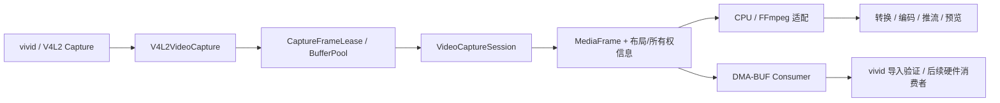
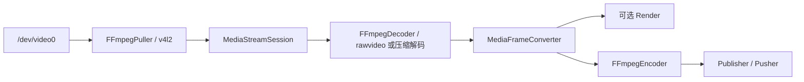

# src-cpp V4L2 视频采集接入规划

日期：2026-10-09。状态：设计规划，尚未实施采集代码。

## 1. 目标与推荐方案

为 `src-cpp` 增加 Linux 本地视频设备输入，使摄像头或采集卡的视频进入现有转换、编码、推流及可选渲染模块。

根据当前开发目标，推荐以原生 V4L2 为主线：先在 vivid 上完成采集、业务回调、缓冲区租借与 DMA-BUF 导出/导入验证，再迁移到实际设备。FFmpegPuller 的 V4L2 输入仅作为采集结果和格式行为的对照，不作为核心采集后端。首阶段必须覆盖原始视频，不能只支持 MJPEG/H.264：当前虚拟机的可用测试设备输出原始像素。

开发范围：单路、单平面 capture API、YUYV/NV12/I420 原始视频，输出统一为现有 `MediaFrame`；先建立复制基线，再完成 MMAP 租借帧及 DMA-BUF 传递。DMA-BUF 属于本轮业务开发主线。音频、CSI media-controller 配置、多平面扩展和真实设备硬件消费者适配分阶段推进。

用户当前通过 `sudo modprobe vivid n_devs=1` 创建模拟设备。本规划的开发环境就是 vivid，不以接入真实摄像头作为业务开发的前置条件。

本规划只新增文档。本次远端操作为环境与源码检查，未修改源码、设备格式、权限或驱动，也未执行实际采集。后文命令与指标为实施阶段操作和验收目标。

## 2. 本地与远端检查结果

本地 C++ 根目录为 `E:/project/video-monitor/src-cpp`；远端对应根目录为 `/home/ub22/mxxmstar/video-capture`，不是远端的 `video-capture/src-cpp`。

通过 SSH 检查 `192.168.117.131`，并按统一换行后的 SHA-256 比较以下文件，结果全部一致：`CMakeLists.txt`、`puller_config.h`、`ffmpeg_puller.cpp`、`stream_session.cpp`、`ffmpeg_decoder.cpp`。这是关键文件核对，不代表对全部文件进行了校验。

| 检查项 | 实际结果 | 对方案的影响 |
| --- | --- | --- |
| 系统 | Ubuntu 22.04.5 LTS，x86_64，内核 6.8.0-138-generic | 可直接使用 Linux V4L2 API |
| 工具 | 已有 `v4l2-ctl`，已加载 `vivid` | 无需先安装虚拟摄像头驱动 |
| `/dev/video0` | vivid Video Capture，支持 Streaming；当前 640x360、YUYV、5 fps | 首个原始视频集成测试入口 |
| 其他节点 | video1 为 Video Output，video2 为 Metadata Capture，video3 为 Metadata Output | 不能把每个 `/dev/video*` 都当作视频输入 |
| 格式枚举 | video0 至少支持 YUYV、UYVY、YU12、NV12、NV21 等 | 优先验证 YUYV 和 NV12/I420 |
| 权限 | ub22 未加入 video 组，但 video0 ACL 授予 ub22 读写权限，查询成功 | 当前用户可访问；服务账号需要另行检查 |
| FFmpeg | 环境开发包包含 V4L2 输入设备及相关 AVOptions | 可复用 libavdevice |
| 设备注册 | 独立 Python ctypes 进程中，注册前 `av_find_input_format("v4l2")` 为空，调用 `avdevice_register_all()` 后非空 | 库调用方必须显式完成设备注册 |

FFmpeg 开发包路径：`/home/ub22/vcpkg_env/ffmpeg-n8.1-latest-linux64-gpl-shared-8.1`。检查使用该包的命令行工具与动态库。

现有设备是内核测试设备 vivid，不是真实 USB 摄像头。原始格式测试可在此完成；MJPEG/H.264、USB 带宽、热插拔和实际图像质量必须在目标硬件验证。

## 3. 现有代码可复用部分与缺口

以下路径均相对于 `src-cpp`。

| 文件/模块 | 当前实现 | 计划处理 |
| --- | --- | --- |
| `include/media/puller/puller_config.h` | 已有 `input_format` 与 `extra_av_options` | 首次实验可直接传 V4L2 AVOptions；随后增加类型化配置 |
| `src/media/puller/ffmpeg_puller.cpp` | 显式选择 demuxer、读 AVPacket、构造流信息、持有中断回调 | 增加一次性设备注册，检查设备取消能力、非阻塞行为与错误映射 |
| `include/media/puller/i_puller.h` | 只提供 packet 输出；注释提到非阻塞终止，但没有相应方法 | 第一阶段沿用 packet；需要时增加明确的 `RequestStop()` 契约 |
| `src/media/stream/stream_session.cpp` | 实际创建 `std::thread` 读取；Stop 调 Close 后 join；支持重连与时间轴策略 | 复用生命周期；修正与线程实现不一致的头文件说明，验证停止与重连 |
| `include/media/media_packet.h` | 没有 RAWVIDEO codec；已有 JPEG | 增加 RAWVIDEO，不能把原始像素标成 UNKNOWN 或 JPEG |
| `include/media/media_frame.h` | 已有 NV12/NV21/I420/RGB/BGR/GRAY；没有 YUYV/UYVY | 第一阶段增加 YUYV422；UYVY 按实际范围扩展 |
| `include/media/ffmpeg_format.h` | RAWVIDEO 映射缺失；JPEG 只有 From 映射，To 映射缺失 | 补齐 RAWVIDEO/JPEG 双向 codec 映射与像素映射 |
| `src/media/decoder/ffmpeg_decoder.cpp` | 显式支持 JPEG/H.264 等；视频 pix_fmt 固定为 NONE | 增加 rawvideo 解码适配，使用已协商的像素格式 |
| `converter`、`encoder`、`publisher`、`pusher` | 已有帧转换和编码输出能力 | 复用，按目标选择 I420/NV12；压缩包直推另测兼容性 |
| `src/media/stream/stream_source.cpp` | 骨架，且被 CMake 排除 | 首版测试直接组合 Session 与下游，不依赖 Source 完成 |
| `src/main.cpp` | 仅 Hello World | 需要独立采集示例/集成测试，尚无可直接切换的完整应用入口 |
| `CMakeLists.txt` | 已链接 avdevice；递归收集媒体 cpp | FFmpeg 路径无须新库；原生实现需 Linux 条件编译 |

两个特别需要防止的误判：

- 链接 `avdevice` 不等于已经注册 V4L2；本次独立进程检查证实需要注册。
- `SessionConfig` 有 watchdog/jitter 配置，但当前读循环未执行对应监控/缓冲逻辑。不能把配置字段当作已具备采集超时保障。

## 4. 两条接入路径

| 项目 | A：FFmpeg V4L2 输入 | B：原生 V4L2 |
| --- | --- | --- |
| 采集层 | libavdevice 管理设备与 MMAP | 自行管理 ioctl、poll、MMAP |
| 对现有接口的影响 | 沿用 IPuller packet 输出 | 原始帧更适合独立 frame 采集接口 |
| 实施成本 | 较低，但要补 rawvideo 和取消行为 | 较高，需完整资源和线程设计 |
| 能力边界 | 受实际 FFmpeg build/backend 限制 | 可控制 buffer 数量、设备 controls、多平面 |
| 停止保障 | 必须实测，interrupt callback 不保证能打断驱动阻塞 | 非阻塞 fd + poll + eventfd 可明确唤醒 |
| 适用阶段 | 首版验证、标准 UVC/普通 capture 设备 | 严格停止时限、厂商设备、多平面或 DMA-BUF 需求 |

本工程选择 B 为主线，A 用于命令行或独立程序对照。原生路径提供显式缓冲区管理和 DMA-BUF 扩展点，并使用非阻塞 fd + poll + eventfd 实现停止。不要靠强制终止线程解决卡住的问题。

### 4.1 主线数据流与 FFmpeg 对照

原生业务链路：



FFmpeg 对照链路：



RAWVIDEO 通过 AVPacket 进入 rawvideo decoder 仅用于 FFmpeg 对照路径。原生路径直接产生 MediaFrame，跳过 decoder；设备 MMAP、帧租借、转换与编码的拷贝要分别测量。

MJPEG 每张图独立解码；H.264 保留源 PTS/DTS 与关键帧信息。若选择压缩码流直推，需要独立确认 SPS/PPS、码流封装、目标容器及推流器支持情况，不能跳过这些条件。

### 4.2 原始视频契约

1. 原生采集不需要增加 RAWVIDEO packet codec；如果实现 FFmpeg 原始视频对照，再增加 `CodecType::RAWVIDEO`、双向映射与 decoder 分支。
2. 增加 `PixelFormat::kYUYV422` 与映射；首版必须打通当前 video0 的 YUYV。NV12/I420 沿用现有枚举。
3. `VideoStreamInfo` 保存实际协商尺寸与像素格式。rawvideo decoder 不能像压缩码流一样将 pix_fmt 留为 NONE，应由流信息赋值并校验。
4. FFmpeg 路径先确认交付 AVPacket 是否为标准紧凑布局、是否正确处理设备 padding。对未知布局拒绝适配；不能仅按 `width * height * bytes_per_pixel` 假定所有驱动的有效载荷。
5. 原生路径逐行按 bytesperline 复制至拥有所有权的紧凑帧；多平面路径逐平面处理。记录 sizeimage、bytesused、data_offset，校验范围，不能越过映射长度。
6. YUYV 转编码常用 I420/NV12；MJPEG 可能解出 YUVJ422P 等当前枚举不覆盖的格式，应先在 AVFrame 层转换成受支持格式，或补齐枚举，不能把 Unknown 直接交给消费者。
7. 色彩空间、量化范围与隔行属性不能默默丢失。首版选择 progressive 模式，转换按设备信息配置；完整字段扩展视真实设备需要实施。

## 5. FFmpeg 对照路径实施细节

本节作为可选对照方案，不阻塞原生采集和 DMA-BUF 开发。注册、RAWVIDEO 解码和 Session 修改只在实际采用该对照程序时实施。

### 5.1 最小配置与类型化配置

下面使用当前已有配置类型，表示实施后的调用方式。当前代码尚不能完成原始视频链路。

```cpp
FFmpegPullerConfig config;
config.input_format = "v4l2";
config.extra_av_options = {
    {"video_size", "640x360"},
    {"framerate", "5"},
    {"input_format", "yuyv422"},
    {"timestamps", "default"},
};
InputEndpointConfig endpoint;
endpoint.uri = "/dev/video0";
endpoint.puller_kind = PullerKind::FFmpeg;
```

`config.input_format="v4l2"` 选择输入设备；字典中的 `input_format="yuyv422"` 选择设备输出像素格式；设备若支持 MJPEG，此处可使用 `mjpeg`。二者名称相同但含义不同，建议后续引入 `V4L2InputOptions`：尺寸、`Rational` 帧率、设备格式名、时间戳模式、协商策略。它放入 `FFmpegPullerConfig`，首版不增加 `PullerKind::V4L2`。

避免两个来源覆盖同一选项：类型化配置与 extra_av_options 发生重复时拒绝配置或明确报错。记录请求值与实际协商值，默认严格检查尺寸/格式；允许协商降级必须由调用者显式配置。

`FFmpegPuller::Open` 当前拒绝 `PullerKind::Auto`，所以示例必须显式指定 FFmpeg，不能指望 `/dev/video0` 被自动选择为 V4L2。

### 5.2 初始化与读循环

- 在 FFmpeg 初始化路径使用 `std::call_once` 调用 `avdevice_register_all()`，包含 `libavdevice/avdevice.h`。设备支持检查和注册仅在相关平台/功能开启时执行。
- 仍使用现有 avformat_open_input / 流信息读取，限制探测时间与包数；不要默认沿用为网络视频设置的低延迟参数。
- 实测 `AVFMT_FLAG_NONBLOCK` 对当前 backend 的影响。确认 EAGAIN 表示暂时无数据时，将它映射为 `NoData`，而不是当前的 `RetryableError`，否则每次空读都会触发重连。变化应按 backend 行为限定，并回归网络输入。
- NoData 等待避免忙循环；现有 1 ms backoff 作为起点，测 CPU 后调整。设备持续无帧另设 idle deadline，达到阈值才报告超时。
- 无设备、权限不足、忙、格式不支持应有明确原生错误码与可重试标记，不能统一归为 Network。

### 5.3 停止与并发，作为发布门槛

当前 Close 设置 stop_requested 后等待 io_mutex；ReadPacket 持锁调用 av_read_frame。只有底层读及时返回，Close 才能继续。V4L2 驱动 read/ioctl 不一定检查 FFmpeg interrupt callback，网络输入的取消经验不能直接套用。

要求验证正常采集、无帧、打开探测、设备异常四种 Stop 情形。尤其 Session 的 Open/重连持生命周期锁，Stop 可能等锁后才调用 Close；只新增 RequestStop 声明不能解决这一问题。

如果需要增加 `IPuller::RequestStop()`，应为所有已有实现和 mock 定义行为：调用快速返回、可与 Open/Read 并发、取消不被 Open 的重置逻辑吞掉；资源释放仍由 Close 串行完成。Session 应在等待生命周期锁前能通知正在执行的操作，且保证 puller 对象仍存活。按操作代次处理取消与重新打开竞态。

FFmpeg 无法可靠取消时，采用原生后端。不要从另一线程直接关闭正在使用的 AVFormatContext，也不要用 detach 逃避资源回收。

## 6. 原生 V4L2 主线设计

建议新增 `include/media/capture/` 和 `src/media/capture/`，提供 `IVideoCapture`、`V4L2CaptureConfig`、`V4L2VideoCapture`，同步 `ReadFrame()` 返回 Frame/NoData/Stopped/RetryableError/FatalError。这是本轮核心实现。

原始视频直接输出 `MediaFrame`，不硬塞入只表达编码包的 IPuller。复用已有重连策略配置，增加小型采集会话管理线程与 frame 回调；不立即把整个 MediaStreamSession 改成 packet/frame variant。如果未来业务要求完全统一，再基于实际重复代码设计共同输入接口。原生压缩采集如有需求可另外提供 packet 适配。

生命周期：

```text
open(O_RDWR | O_NONBLOCK | O_CLOEXEC)
  -> QUERYCAP（有 DEVICE_CAPS 时使用 device_caps）
  -> ENUM_FMT / ENUM_FRAMESIZES / ENUM_FRAMEINTERVALS
  -> TRY_FMT / S_FMT / G_FMT；S_PARM / G_PARM
  -> REQBUFS(MMAP，起始请求 4 个，以实际返回数量为准)
  -> QUERYBUF / mmap / QBUF 全部 buffers
  -> STREAMON
  -> poll(video_fd + stop_eventfd) / DQBUF
  -> 检查 flags、sequence、timestamp、bytesused
  -> 复制或逐行转换至自有帧 / QBUF / 交付
  -> 停止唤醒 / 结束读取 / STREAMOFF / munmap / close
```

所有部分初始化失败都逆序回收。EINTR 在未取消时重试；EAGAIN 返回 NoData；ENODEV/POLLHUP 作为断开处理；异常 buffer 丢弃并计数，持续异常达到阈值后报告故障。poll 超时与“设备损坏”分开处理。

单平面 `VIDEO_CAPTURE` 不等于像素只有一个平面；NV12 可以通过一个连续 V4L2 buffer 包含 Y/UV。多平面 `VIDEO_CAPTURE_MPLANE` 需要独立的 v4l2_plane 数组、逐平面 mmap 和 offset 校验，首版明确拒绝该能力，后续实现。

第一版选择“DQBUF 后复制，立即 QBUF”，确保下游不会长期占用设备 buffer。帧池和有界队列用于减少分配：预览/分析原始帧队列可从 2 帧起步，满时丢弃最旧帧并计数；编码包不能照搬该策略，否则可能破坏 GOP。

租借与 DMA-BUF 阶段必须解决：最后一个引用释放时回收 buffer、Close 后映射存活、旧连接帧与新连接隔离、buffer 全被下游持有时背压，以及任意线程析构如何通知采集线程 QBUF。不能只把 mmap 指针包装成 SimpleBuffer。

### 6.1 三种内存模式与零拷贝边界

| 模式 | 数据交付 | 可以证明什么 |
| --- | --- | --- |
| Copy | DQBUF 后复制到自有帧并立即 QBUF | 业务、格式、时间戳和性能基线 |
| MmapLease | MediaFrame 租借 capture buffer，最后一个引用释放后 QBUF | 采集到 CPU 消费者没有应用层像素复制，不等于 DMA 链路 |
| DmaBufExport | MMAP 分配后 EXPBUF 导出 fd，帧携带 fd 与布局，消费者导入 | 跨模块共享同一缓冲区；实际硬件端到端零拷贝仍需目标消费者验证 |

配置中区分 `CaptureMemoryMode` 与消费者能力，避免用一个 zero_copy 布尔值混淆这些模式。严格模式导出/导入失败应报错；允许复制回退必须显式启用，并在日志与统计中暴露。

### 6.2 DMA-BUF 导出与导入验证

1. 在 capture 的 MMAP buffers 初始化后逐 buffer 调用 `VIDIOC_EXPBUF`，设置 CLOEXEC；多平面扩展时逐 V4L2 memory plane 导出 fd。MMAP 支持不自动意味着 EXPBUF 支持，按实际 ioctl 结果判定。
2. vivid 常使用 vmalloc backing，可用来验证共享缓冲区 API，但不能据此声称物理连续、特定 DMA 地址或真实 ISP/GPU 的可导入性。本次尚未调用 EXPBUF，导出能力留待实现验证。
3. 已有 `/dev/video1` 是 vivid Video Output，可作为 DMA-BUF 导入测试候选：匹配格式后使用 `REQBUFS(V4L2_MEMORY_DMABUF)`，将导出 fd 交给 output 的 QBUF。导入支持同样需实测，不通过则明确记录 API/驱动限制。
4. capture buffer 被 output 或其他消费者使用时必须保持租借；output DQBUF 表示本次消费结束，再释放对应引用，最后才可重新 QBUF 到 capture。output pipeline 的 STREAMOFF 也要完成释放。
5. 区分导出测试、导入测试与闭环图像验证。捕获 vivid 测试图案并送到 output 足以验证队列与持有关系；如启用 vivid loop_video 验证回环，应另设测试阶段，避免输入/输出互相依赖导致启动死锁。
6. 从外部 allocator 分配 DMA-BUF，再由 capture 使用 MEMORY_DMABUF 导入，是另一种所有权模式。只有后续设备或消费者要求时增加；不能用“支持 EXPBUF”代替对 capture 导入能力的验证。

### 6.3 帧描述与资源所有权

新增 `CaptureFrameBuffer` / `CaptureFrameLease`，通过共享 pool state 持有映射与 fd。帧携带 capture generation、buffer index、sequence、timestamp 与实际布局；DMA-BUF 描述至少包含 fd 所有权、分配长度、有效载荷、stride、offset，以及像素格式/尺寸/色彩信息。

注意 V4L2 memory plane 和图像 color plane 不一定一一对应：单平面 NV12 的 Y/UV 可共享同一个 fd，通过 offset 描述。单个 fd 的长度不能用某一 color plane 的有效长度替代。DRM modifier 如消费者需要，应明确其来源；未知时不能猜测 tiled 或 linear。

不将 fd 当作 `BackendHandle::ptr`。IMediaBuffer 当前只能描述连续数据，零拷贝帧需要专用平面/DMA 描述接口；CPU 可映射帧可提供连续视图，无法 CPU 访问的 DMA 帧必须返回非连续/不可直接访问状态。FFmpeg AVFrame 适配可使用 AVBufferRef 自定义释放回调持有 lease，保持 stride 与真实平面地址；现有 converter/encoder 必须先确认 backend 契约，必要时提供显式适配层。

所有租借释放只投递 recycle 通知，由采集线程检查 generation 和运行状态后 QBUF。Close 先停止交付、唤醒、等待 I/O 线程退出，再 STREAMOFF；下游仍持有的映射和导出 fd 由旧 pool state 延迟释放。新一代采集创建新的 pool，不把旧 index 回收到新 fd。

DMA-BUF CPU 读写遵循 exporter 的同步要求；通过 DMA-BUF 映射进行 CPU 访问时，使用 `DMA_BUF_IOCTL_SYNC` START/END 并检查错误。它用于缓存一致性，不替代消费者完成通知/fence，也不替代 capture/output 的队列所有权。硬件消费者同步协议在迁移时按实际 API 明确。

### 6.4 业务背压与实际消费者

建议起始 4 个 buffers，同时限制异步业务队列与在途租借数量，保留可回到 capture 的 buffer。全量租借耗尽时等待释放或丢弃尚未交付的原始帧；已经被消费者持有的 buffer 不能强制复用。

现有 swscale 转换和软件编码需要 CPU 访问，转换会生成新图像，软件编码也可能有内部复制。因此首版可交付“采集到业务帧无应用层复制”和“DMA-BUF 导出/导入通过”，不能将当前软件推流链路标为端到端 DMA 零拷贝。后续设备若提供硬件 encoder/GPU，增加消费者适配并核实格式、stride、modifier、缓存与完成通知，才能验收该段零拷贝。

## 7. 时间戳、重连与下游集成

- Packet 的 PTS/DTS/duration 使用自身 time_base；MediaFrame 使用微秒，原生采集显式转换 V4L2 时间戳，FFmpeg 对照沿用 decoder 重标定。0 是有效时间戳，缺失使用 kNoTimestamp。
- 原始帧无编码重排，可在时间戳有效时令 DTS=PTS，每帧视为独立可解码帧；必须确认 keyframe 标记，以免 Session StartAtZero 丢弃全部原始帧。H.264 不能强行将所有包标为关键帧或将 DTS 改成 PTS。
- 首版保留内核时间戳，不默认 mono2abs。原生路径记录 timestamp flags 的时钟域；系统时间、monotonic 与媒体时间不能混减。
- 重连后重新查询格式、重建 decoder/converter/encoder 的必要状态；旧连接在下游队列中的包/帧先排空或丢弃，避免旧数据进入新连接。现有 Session 没有可直接依赖的公开 generation 标记。
- 重连选择 Session scope 可延续逻辑时间轴；Connection scope 从新连接零点开始。需要校验时间基、格式变化和首关键帧行为，不能仅靠配置名称认定连续性。
- 设备消失、忙或超时按配置执行有界退避；权限错误、非法参数、非 capture 节点立即失败。插拔后优先使用稳定的 `/dev/v4l/by-id` 路径，虚拟设备则使用明确节点。
- 新采集 Session 的下游 callback 应快速返回。长时间转换/编码如需异步，使用已有队列工具建立有界队列，明确拥塞策略与在途 lease 上限。

## 8. 文件级实施清单与阶段

| 阶段 | 主要工作与文件 | 完成条件 |
| --- | --- | --- |
| P0 vivid 基线 | 复用当前 `modprobe vivid n_devs=1` 环境，检查 capture/output 节点、格式与权限；有限帧对照采集 | 记录实际格式与命令行结果 |
| P1 原生业务闭环 | 新增 `capture/i_video_capture.h`、`v4l2_capture_config.h`、`v4l2_video_capture.h/.cpp`、`video_capture_session.h/.cpp`；补 YUYV 像素映射 | Copy 模式采集 -> MediaFrame -> 转换 -> 编码/推流；正常和无帧 Stop 可控 |
| P2 MMAP 租借 | 新增 `capture_frame_buffer.h/.cpp`、buffer pool/lease 与 FFmpeg 帧适配；有界业务队列 | 采集到业务消费者无应用层像素复制，跨线程释放和 Stop 后持帧通过 |
| P3 DMA-BUF | 新增 DMA-BUF 帧描述；EXPBUF 导出；独立 vivid output DMABUF 导入测试 | 实测能力、共享 fd 生命周期、消费完成后回收、同步行为，失败有明确能力结果 |
| P4 可靠性与性能 | syscall 测试替身、故障/重连、长跑与拷贝统计；Linux 条件构建 | 无旧代 buffer 混用；Copy/Lease/DMA 模式结果可对比；现有业务回归通过 |
| P5 设备迁移 | 按真实驱动适配多平面/CSI，连接硬件 encoder/GPU 消费者 | 真机格式与缓存同步正确，逐段证明硬件链路零拷贝 |

顺序建议：P0 -> P1 -> P2 -> P3 -> P4 -> P5。P1 的复制实现保留为功能与性能对照，不在引入租借时删除。P3 若发现 vivid 不支持所需导入/导出，应保留接口、补充 mock 生命周期验证并报告限制，将实际共享验证移到支持该能力的设备；不能用 mock 通过宣称真实 DMA 路径通过。工作量主要取决于驱动与消费者差异，不在验证前承诺固定工期。

构建注意：

- FFmpeg 路径已有 avdevice 链接，无需新增 libv4l2 依赖；`use_libv4l2` 不默认启用，只有实际 FFmpeg build 支持并有转换需求时才使用。
- 原生源文件不能因 GLOB_RECURSE 在 Windows 自动编译；增加 Linux 平台判断和功能开关，在其他平台排除实现文件与测试目标。
- 集成测试接收设备路径参数，显式启用，不放入默认全量硬件无关 CTest。当前 test/media 使用 GLOB 自动注册测试，新增设备测试时须排除后单独注册，避免普通 CI 等待设备。
- `MEDIA_RAW_FRAME_BUFFER=OFF/ON` 都验证；该选项表示帧缓冲实现方式，不表示摄像头是否输出 rawvideo。

## 9. 实施阶段命令

以下命令在远端执行。格式设置和采集会使用设备，需避开已有使用者；320/640 等目标模式以设备枚举结果为准。

```bash
cd /home/ub22/mxxmstar/video-capture
source /home/ub22/vcpkg_env/env.sh

v4l2-ctl --list-devices
v4l2-ctl -d /dev/video0 -D
v4l2-ctl -d /dev/video0 --get-fmt-video --get-parm
v4l2-ctl -d /dev/video0 --list-formats-ext
ffmpeg -hide_banner -h demuxer=v4l2

# 有限帧命令行基线，不写视频文件；外层 timeout 防止设备异常挂住。
timeout 15s ffmpeg -hide_banner -nostdin \
  -f v4l2 -input_format yuyv422 -video_size 640x360 -framerate 5 \
  -i /dev/video0 -frames:v 20 -an -f null -

cmake -S . -B build-v4l2 -G Ninja \
  -DCMAKE_BUILD_TYPE=Release -DFFMPEG_ROOT="$FFMPEG_ROOT" \
  -DBUILD_RENDER=OFF -DBUILD_TESTS=ON -DBUILD_MEDIA_TESTS=ON
cmake --build build-v4l2 --parallel 2
```

第二个独立构建目录设置 `-DMEDIA_RAW_FRAME_BUFFER=ON`。测试程序的命令行参数与 CTest 名称在实现时确定，当前不提供不存在目标的可执行命令。

如果未来需要无摄像头环境，优先使用已加载的 vivid。v4l2loopback 需要额外的生产者喂帧，不能当成加载后即能输出画面的测试设备。权限修正只对目标服务账号按环境实施，避免一律 chmod 666。

## 10. 验证矩阵与验收标准

| 层次 | 测试内容 | 判定 |
| --- | --- | --- |
| 契约测试 | RAWVIDEO/JPEG 映射、YUYV 映射、尺寸/格式检查、time_base 重标定 | 不把有效 rawvideo 标为 UNKNOWN；时间单位正确 |
| 生命周期测试 | Open 失败清理、重复 Close、空闲读取 Stop、Open/Stop 竞态 | 无泄漏/悬挂读取；取消不被重新打开覆盖 |
| vivid 集成 | YUYV、NV12/I420，packed/raw 两模式，转换后编码文件 | 帧数、尺寸、有效 PTS 正确，ffprobe/解码通过 |
| 租借专项 | 多消费者持帧、异步释放、持帧期间 Stop/重启、buffer 耗尽 | 无提前 QBUF、use-after-free 或旧代回收；frame buffer 保持有效 |
| DMA-BUF 专项 | EXPBUF、output MEMORY_DMABUF 导入、重复 fd/引用、失败清理 | 能力结论来自实际 ioctl；完成前不复用，fd 无泄漏 |
| 故障测试 | EAGAIN、异常 buffer、断流、设备消失、权限、设备忙 | 可重试与不可重试分类正确；无无限空转 |
| 原生后端专项 | 每阶段 ioctl/mmap 失败、多平面拒绝、stride/padding | 逆序回收，边界检查，错误明确 |
| 真机测试 | USB 摄像头/采集卡支持的 raw/MJPEG/H.264、插拔 | 格式协商、恢复、实际画面与带宽符合要求 |
| 回归 | 现有本地媒体测试、Windows 构建、网络输入脚本测试 | 既有拉流/时间戳/推流不回退 |

建议初始验收目标，需按设备帧率和性能约束复核：

- 正常/无帧读取时 Stop 在 500 ms 内返回；连接或格式协商中的取消另测，目标同为 500 ms，不以 connect_timeout 替代取消验证。
- 连续运行至少 30 分钟；100 次启动/停止后 fd、映射与工作线程数量回到基线，内存无持续增长。
- 原始采集在设备实际协商帧率下达到预期；记录采集、转换、编码和队列丢帧各阶段统计，不能把虚拟机调度抖动误认作驱动性能。
- 持续无帧在配置的 idle_timeout 后报告超时；短暂 EAGAIN 不重连；禁用重连时故障及时结束。
- 下游输出能由 ffprobe 检查并完整解码，PTS 单调且单位正确；真机观察色彩、UV 顺序、行错位与隔行问题。
- 零拷贝单独验收：Copy 模式统计复制字节作为基线；Lease 模式采集交付阶段复制字节为 0，并检查数据地址与 buffer index；DMA 模式以成功导出/导入和生命周期验证为证据。统计不包含驱动/硬件内部不可观测复制，软件转换和编码的复制另外报告。

当前 `docs/README-linux-vcpkg.md` 记录了一项已知 Linux 推流会话测试失败：`Async event did not interrupt blocked Push`。它属于现有输出会话基线，实施时复测并单独记录；本次未重新运行媒体测试，不能宣称现有全部测试通过。

## 11. 实施前需要落定的产品参数

已明确“先在 vivid 上开发原生 V4L2 业务与 DMA-BUF，再迁移设备”。开发默认采用单路原始视频、当前 640x360/5 fps 起步，以业务帧交付和编码输出验证；目标设备类型、最终分辨率/帧率、音频、主要消费者和最终延迟预算在迁移前确定。

若目标为嵌入式 CSI/ISP、多平面设备或厂商私有 API，迁移时枚举 capabilities 和 media graph，扩展已建立的原生后端及消费者适配。vivid 用于业务、缓冲区共享与生命周期开发，不替代真机 DMA 连通性和性能验收。

## 12. 参考

- 工程输入设计：[media-input-puller-session-source-design.md](media-input-puller-session-source-design.md)
- 工程输出设计：[media-output-design.md](media-output-design.md)
- Linux 环境说明：[README-linux-vcpkg.md](README-linux-vcpkg.md)；其中旧源码目录为 application，本规划以用户指定的 video-capture 为准。
- Linux V4L2 API：<https://www.kernel.org/doc/html/latest/userspace-api/media/v4l/v4l2.html>
- FFmpeg V4L2 设备：<https://ffmpeg.org/ffmpeg-devices.html#video4linux2_002c-v4l2>

外部链接供实施查阅；本次具体 FFmpeg 选项以远端 `-h demuxer=v4l2` 输出为依据。
