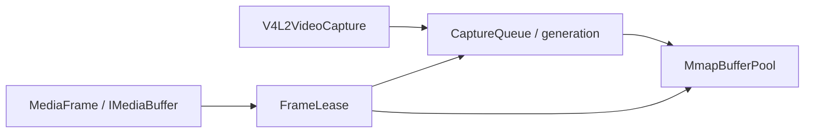

# 原生 V4L2 第一阶段：队列、存储与帧租约

实现位置：Linux 工程 `/home/ub22/mxxmstar/video-capture`。
本阶段支持单个 V4L2 memory plane 的 MMAP 采集，像素格式为 YUYV、NV12、I420。
NV12/I420 的图像平面仍位于同一个 V4L2 缓冲区中，不等于 `VIDEO_CAPTURE_MPLANE`。

## 职责和所有权

| 对象 | 负责 | 生命周期结束时 |
| --- | --- | --- |
| `V4L2VideoCapture` | 设备 FD、格式/帧率协商、STREAMON/OFF、ReadFrame、停止通知 | 停流、退役队列、关闭设备 FD |
| `CaptureQueue` | REQBUFS/QUERYBUF/QBUF/DQBUF、slot 状态、generation、归还通知 eventfd | 归还通知 FD 关闭；设备 FD 仅借用 |
| `MmapBufferPool` | mmap/munmap、地址和映射长度 | 最后一个持有者释放后 munmap |
| `FrameLease` | 一个出队缓冲区的使用权，持有队列和映射存储 | 最后一个引用释放时通知原队列；自身不调用 ioctl |



队列不持有租约，因此没有引用环。关闭后队列释放自己的存储引用，未释放的租约
继续持有旧存储。采集对象被销毁也不影响已返回帧的数据。

## 队列状态和线程边界

正常路径：`Queued -> Leased -> RecyclePending -> Queued`。
关闭时所有 slot 进入 `Retired`；退役队列不能恢复，重开创建新 generation。
DQBUF 与建立租约在采集入口内完成，对外不暴露中间的出队状态。

`Open`、`ReadFrame`、`Close` 通过采集对象的 I/O 锁串行执行。
REQBUFS、QUERYBUF、QBUF、DQBUF 只由这些串行入口调用。
消费线程最后释放 `FrameLease` 时，只在队列锁下标记 `RecyclePending` 并写 eventfd。
`ReadFrame` 在等待前和收到归还通知后扫描待归还 slot，执行 QBUF。
析构归还路径不分配内存。

队列耗尽时，ReadFrame 等待归还或停止通知，不把驱动的无缓冲区 POLLERR 当作拔设备。
一次归还通知可能使 ReadFrame 返回 `NoData`；调用方继续读取即可。
QBUF 失败会保存到队列，ReadFrame 返回带 errno 的错误，直至关闭并重开；不会只写日志。

`RequestStop()` 可跨线程调用，只唤醒读操作；`Close()` 执行停流和实际清理。
旧租约带着原队列对象和 generation；退役后释放它不会访问已经关闭或复用的设备 FD。

## 两种交付模式

```cpp
V4L2CaptureConfig config;
config.device = "/dev/video0";
config.delivery_mode = V4L2DeliveryMode::MmapLease; // 默认
// config.delivery_mode = V4L2DeliveryMode::Copy;
V4L2VideoCapture capture(config);
```

`MmapLease`：MediaFrame.buffer 实际持有 FrameLease，交付时不复制像素。
保留协商得到的 stride 和图像平面 offset，不再在遇到行填充时隐式转成 Copy。
每个平面的最后一个有效字节必须位于 bytesused 范围内。

`Copy`：将有效行复制到独立紧凑缓冲区，在返回帧前归还驱动 slot。
适合长期缓存、慢消费者和需要独立修改像素的业务。

多消费者必须各自持有 `shared_ptr<MediaFrame>` 或共享 buffer；只保存 Data() 原始指针
不能延长租约。最后一个 buffer 引用释放才允许复用该驱动缓冲区。
FrameLease 保持现有 IMediaBuffer 的可写 Data() 接口兼容，但共享帧应按只读使用；
多个消费者写同一帧仍需要业务同步或独立拷贝。

租约模式有明确背压：业务持有全部驱动缓冲区时，采集暂停等待，不抢回未释放的帧。
buffer_count 至少为 2；应用应限制排队和持帧数量。保留多次重开的旧帧也会保留多代映射
以及对应队列的通知 FD，直到这些帧释放。

## 停止与重开

关闭顺序：停止唤醒 -> 等待读入口退出 -> STREAMOFF -> 队列退役 -> REQBUFS(0) -> close(device)。
无存活租约时先 munmap；有存活租约时依赖驱动的 orphaned buffer 能力解除旧队列。
vivid 已验证可在持有旧帧时重开，新旧 generation 同时存在且内容互不覆盖。

实机驱动不支持 orphaned buffer 时，REQBUFS(0) 可能返回 EBUSY，程序记录该错误；
重开也可能继续返回 Busy，直到旧帧全部释放。业务应先释放旧租约或选择 Copy。
不能为了重开而提前 munmap 活跃帧，也不能认为所有 V4L2 驱动均支持此能力。

## 验证入口

```sh
source /home/ub22/vcpkg_env/env.sh
cmake -S . -B build -DBUILD_V4L2_DEVICE_TESTS=ON
cmake --build build --target test_capture_contract v4l2_lease_test v4l2_capture_smoke -j4
ctest --test-dir build -R '^test_capture_' --output-on-failure
```

设备测试需要独占设备。`V4L2_TEST_DEVICE` 默认为 `/dev/video0`。
三种格式分别验证：耗尽队列、多消费者最后引用、跨线程归还唤醒、阻塞读停止、
旧帧跨 Close/Open、反复重开、采集对象销毁后持帧，以及 Copy 模式长期持帧。
最后释放所有帧后，检查 `/proc/self/fd` 和设备映射数量恢复到测试前的基线。
smoke 测试继续验证 Session -> I420 -> H264 -> Publisher/MP4。

保留交互渲染入口（需要 BUILD_RENDER=ON 和图形环境）：

```sh
build/bin/v4l2_capture_smoke --render /dev/video0 yuyv
build/bin/v4l2_capture_smoke /dev/video0 nv12 build/test/capture/manual-nv12.mp4
```

vivid 专属故障注入单独启用，不应对真实设备运行：

```sh
cmake -S . -B build -DBUILD_V4L2_VIVID_FAULT_TESTS=ON
cmake --build build --target v4l2_vivid_fault_test -j4
ctest --test-dir build -R '^test_capture_vivid_faults$' --output-on-failure
```

覆盖 REQBUFS、初次 QBUF、STREAMON 失败、损坏帧和延迟归还 QBUF 失败及重开恢复。

2026-10-16 在 Ubuntu VM 的 vivid `/dev/video0` 上验证：普通构建 8/8 通过；
`build-v4l2-stage1-asan` 无渲染构建在 ASan（开启 leak 检查）和 UBSan 下同样 8/8 通过。
三个格式的 MP4 均经 ffprobe 确认为 H264、640x360、5 fps、12 帧、2.4 秒，
并通过 ffmpeg 完整解码检查。交互渲染入口已编译，本轮未进行窗口交互验证。
故障测试若被中断，vivid 可能保留尚未消费的一次性错误标记，须消费该标记后再跑正常采集测试。

## 后续 DMA-BUF 边界

本阶段没有实现 EXPBUF、V4L2_MEMORY_DMABUF 导入、DMA_BUF_IOCTL_SYNC、fence 或多 memory plane。
后续可替换存储及其引用方式，继续由 CaptureQueue 控制 slot 使用权和回收时机。
必须先明确每个导出/导入 FD 的所有者、图像平面布局和设备同步契约，再接入设备编码器。
当前 MmapLease 仅表示采集交付不复制；现有 FFmpeg 转换/编码路径仍可能复制，
不代表端到端 DMA 零拷贝。
